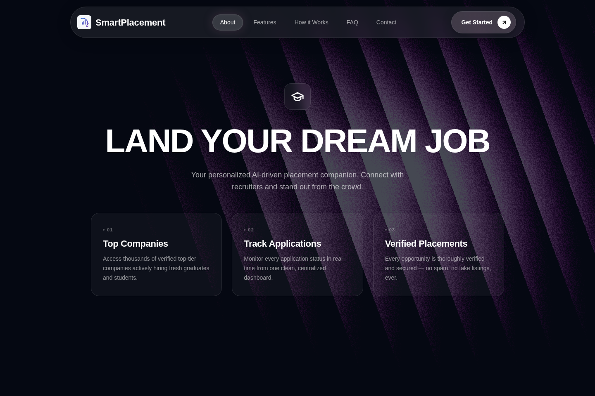
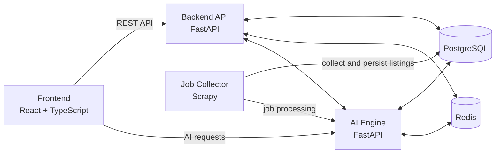

# Smart Placement Tracker

Smart Placement Tracker is an AI-assisted placement platform for students, employers, and placement administrators. Students can discover jobs, manage applications, prepare resumes and interviews, and get skill and role recommendations. Employers manage company profiles, job postings, and applicants; administrators oversee platform activity and placement analytics.

**Main modules**
- **Frontend:** React and TypeScript app with student, company, admin, and authentication experiences.
- **Backend API:** FastAPI service for authentication, profiles, jobs, applications, interviews, and platform administration.
- **AI Engine:** FastAPI service for resume analysis, interview preparation, job matching, skill-gap analysis, and agent workflows.
- **Job Collector:** Scrapy-based service that collects and processes job listings.
- **Data services:** PostgreSQL stores application and job data; Redis supports caching, sessions, and agent state.

## Application

The following is a screenshot of the application's public landing page, captured from the running frontend:



## Architecture



## Getting Started

See [SETUP.md](SETUP.md) and [.env.example](.env.example) for environment and service configuration. Some integrations, including Firebase authentication, AI providers, and cloud file storage, require credentials.

```bash
git clone https://github.com/kulwinderkour/Smart-Placement-Tracker.git
cd Smart-Placement-Tracker
```

Configure `.env` and credentials for the services you intend to run, then follow [SETUP.md](SETUP.md) for the matching Docker Compose setup and migrations.

The Compose configuration exposes the frontend on `http://localhost:3001`, the Backend API and its OpenAPI docs on `http://localhost:8000` and `http://localhost:8000/docs`, and the AI Engine and its docs on `http://localhost:8002` and `http://localhost:8002/docs`.

## API Reference

The Backend API base path is `/api/v1` (except where noted). Use `Authorization: Bearer <access_token>` for authenticated routes. Request bodies are JSON unless marked **multipart**. FastAPI validates request models and documents them at `/docs`.

### Backend API — Authentication

| Method | Route | Purpose; request → response |
|---|---|---|
| POST | `/api/v1/auth/register` | Register with `{email, password, role}` → `UserResponse` (201). |
| POST | `/api/v1/auth/login` | `{email, password}` → access/refresh tokens, role, and onboarding flags. |
| POST | `/api/v1/auth/firebase` | `{id_token, role, email?}` → same token response as login. |
| GET | `/api/v1/auth/me` | Current authenticated user → `UserResponse`. |
| PATCH | `/api/v1/auth/complete-onboarding` | Mark current user's onboarding complete → `UserResponse`. |
| GET | `/api/v1/auth/google` | Begin Google OAuth flow → redirect. |
| GET | `/api/v1/auth/google/callback?code=...` | Complete OAuth callback → redirect. |

### Jobs and applications

| Method | Route | Purpose; request → response |
|---|---|---|
| GET | `/api/v1/jobs?page=&limit=&location=&min_salary_lpa=` | List active jobs; returns `{success, data, meta}`. |
| GET | `/api/v1/jobs/{job_id}` | Get a job → `JobResponse`. |
| POST | `/api/v1/jobs` | Admin creates a job using `JobCreate` → `JobResponse` (201). |
| PATCH | `/api/v1/jobs/{job_id}` | Admin updates supplied job fields → `JobResponse`. |
| DELETE | `/api/v1/jobs/{job_id}` | Admin deactivates the job → 204. |
| POST | `/api/v1/applications` | Apply with `{job_id}` and optional profile, resume, cover-letter, and agent fields → `ApplicationResponse` (201). |
| GET | `/api/v1/applications?status=` | List the current student's applications; optional status filter → `{applications, total}`. |
| GET | `/api/v1/applications/my` | Legacy alias returning the current student's application list. |
| PATCH | `/api/v1/applications/{app_id}` | Update application status, notes, resume, cover letter, next-step date, or offer CTC → `ApplicationResponse`. |
| PATCH | `/api/v1/applications/{app_id}/status` | Admin updates status with `{status}` → `ApplicationResponse`. |

### Student

| Method | Route | Purpose; request → response |
|---|---|---|
| GET | `/api/v1/student/profile` | Current student's profile → `StudentResponse`. |
| PATCH | `/api/v1/student/profile` | Update profile fields (name, contact, education, skills, resume, links) → `StudentResponse`. |
| GET | `/api/v1/student/jobs?page=&limit=&search=&location=&job_type=&company_name=` | Search/filter jobs → paginated job data. |
| GET | `/api/v1/student/jobs/external?limit=` | List external job listings. |
| GET | `/api/v1/student/jobs/{job_id}` | Get job details. |
| GET | `/api/v1/student/companies?page=&limit=&search=&industry_type=` | Search company profiles. |
| POST | `/api/v1/student/upload-resume` | **Multipart** `file` upload → saved resume metadata. |
| GET | `/api/v1/student/resume` | Get current resume metadata. |
| GET | `/api/v1/student/resume/history` | List prior resumes. |
| GET | `/api/v1/student/resume/{resume_id}/url` | Get a signed resume URL. |
| POST | `/api/v1/student/resume/analyze` | `{job_description}` → resume analysis result. |
| GET | `/api/v1/student/resume/analysis/history` | List prior resume analyses. |
| GET | `/api/v1/student/my-interviews` | List the current student's interviews. |

### Administration

| Method | Route | Purpose; request → response |
|---|---|---|
| GET | `/api/v1/admin/stats` | Platform summary statistics. |
| GET | `/api/v1/admin/companies?page=&limit=&search=` | Paginated company list. |
| GET | `/api/v1/admin/companies/{company_id}` | Company detail → `AdminCompanySummary`. |
| GET | `/api/v1/admin/students?page=&limit=` | Paginated student list. |
| GET | `/api/v1/admin/jobs?page=&limit=` | Paginated job list. |
| PATCH | `/api/v1/admin/jobs/{job_id}/status` | Set `{is_active}` → `JobResponse`. |
| POST | `/api/v1/admin/trigger-scrape` | Trigger a job collection run. |
| GET | `/api/v1/admin/applicants?job_id=&status=&page=&limit=` | Search/filter applicants. |
| PATCH | `/api/v1/admin/applicants/{application_id}/status` | Update application status with `{status}`. |
| GET | `/api/v1/admin/interviews?page=&limit=` | Paginated interview list. |
| POST | `/api/v1/admin/interviews` | Create an interview with `{student_id, job_id, scheduled_at, mode}` and optional meeting link/notes → 201. |
| PATCH | `/api/v1/admin/interviews/{interview_id}` | Update interview time, mode, status, link, or feedback. |
| GET | `/api/v1/admin/analytics` | Detailed placement analytics. |
| GET | `/api/v1/admin/analytics/summary` | Summary analytics. |
| GET | `/api/v1/admin/students/{student_id}/resume` | Get a student's resume. |
| POST | `/api/v1/admin/invite-student` | Invite a student with `{student_id, job_id}` and optional message. |


### AI Engine (`http://localhost:8002`)

| Method | Route | Purpose; request → response |
|---|---|---|
| POST | `/ai/resume/analyse` | **Multipart** `file` (PDF/DOCX) → extracted skills, ATS score, breakdown, suggestions, and word count. |
| GET | `/ai/recommend/{student_id}` | Recommend active jobs from student skills → `{success, data, student_id}`. |
| GET | `/ai/skill-gap/{student_id}/{job_id}` | Compare student and job skills → gap result. |
| POST | `/ai/interview/questions` | `{job_title, job_description?, skills?, difficulty?, num_questions?, question_type?}` → generated questions and source. |
| POST | `/agent/match-resume` | `{job_role, required_skills?, resume_text?, resume_path?}` → resume match result. |
| POST | `/api/matcher/score` | `{student, job}` → match score, matched skills, and skill gaps. |
| POST | `/api/matcher/bulk-score` | `{students, job}` → match results sorted by score. |
| POST | `/api/matcher/retrain` | Retrain/reload the matcher model. |
| GET | `/api/matcher/health`, `/model/health` | Matcher/model status and version. |
| POST | `/api/agent/auto-apply` | `{instruction, student_token, student_profile}` plus optional resume URL and pipeline flag → agent response and application results. |
| POST | `/api/agent/validate-job` | `{job_data}` → validity, publishability, quality score, issues, and extracted skills. |
| POST | `/internal/process-job` | `{source_url, company_name, role_title, description?}` → extracted skills linked to the saved job. |
| GET | `/health`, `/redis/health`, `/db/health`, `/api/agent/health` | Service, dependency, and agent health checks. |

## Personal Contribution

Git history attributes project work to Kulwinder Kour. Representative changes include:

- Added application tracking and the student apply-job page ([`a562796`](https://github.com/kulwinderkour/Smart-Placement-Tracker/commit/a562796), [`9cb9621`](https://github.com/kulwinderkour/Smart-Placement-Tracker/commit/9cb9621)).
- Built and refined AI-agent and profile/job-matching workflows ([`daa4bf9`](https://github.com/kulwinderkour/Smart-Placement-Tracker/commit/daa4bf9), [`7fc7bb8`](https://github.com/kulwinderkour/Smart-Placement-Tracker/commit/7fc7bb8)).
- Contributed to the Firebase authentication and Redis/serverless architecture changes ([`6c1b613`](https://github.com/kulwinderkour/Smart-Placement-Tracker/commit/6c1b613), [`c181cfe`](https://github.com/kulwinderkour/Smart-Placement-Tracker/commit/c181cfe)).
- Updated deployment automation and Cloud Build configuration ([`133a07b`](https://github.com/kulwinderkour/Smart-Placement-Tracker/commit/133a07b)).

## Testing

### Run tests

From the repository root, start the services before running backend tests:

```bash
make test
```

Run the frontend checks from `frontend/`:

```bash
npm ci
npm run build
npm run lint
```

The AI Engine includes pytest tests under `ai-engine/tests/` and a standalone intent-parser check:

```bash
cd ai-engine
python -m pip install -r requirements.txt
python -m pip install pytest
python -m pytest -q tests
python tests/test_auto_apply_agent.py
```

### Results from this documentation update

- Backend API: `docker run --rm spt-doc-backend-test python -m pytest -q tests` — **12 passed, 1 failed**. `test_get_profile_not_found` expected HTTP 404 but received 200.
- Backend API host attempt: `python -m pytest -q tests` — did not start because `pytest` is not installed in the host Python environment.
- Frontend: `npm run build` — **passed** (Vite reported a large-chunk warning).
- Frontend: `npm run lint` — **failed: 119 errors and 10 warnings**.
- AI Engine tests were not run for this update.
